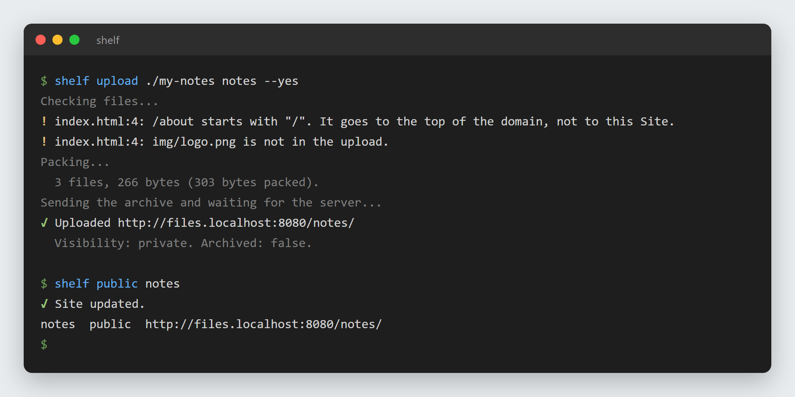
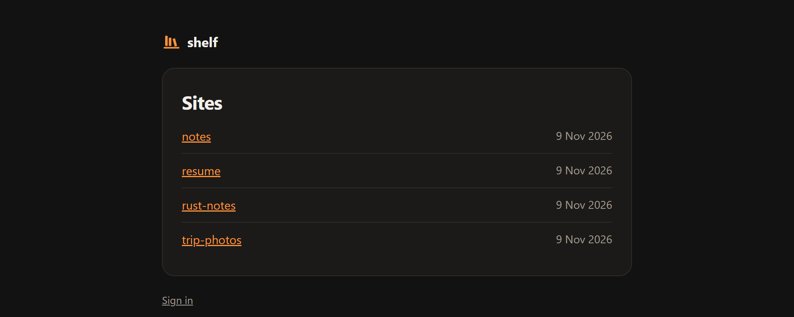
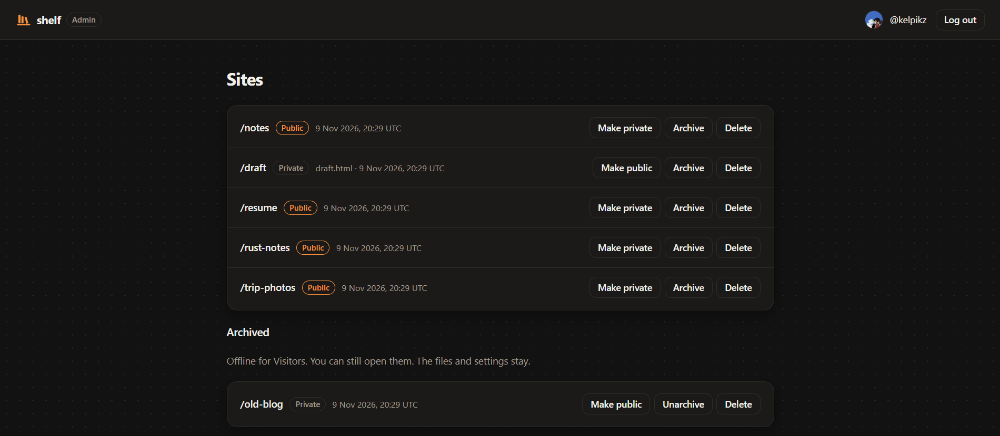
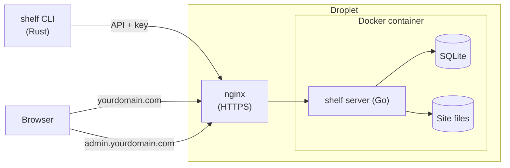

# shelf

[](https://github.com/kelpikz/shelf/actions/workflows/ci.yml)

`shelf` is a small self hostable software to upload and view static files.

```sh
shelf upload ./my-notes notes
# Now online at https://yourdomain.com/notes/
```
The site is currently live at https://files.ajitha.fyi

## Screenshots

**Upload a folder, then make it Public:**



**The Index page lists the Public Sites:**



**The Admin page manages Public, Private, and Archived Sites:**



## Features

- **One command to upload.** Upload a file or a folder to a path. An upload to a path that is in use replaces the Site in one step.
- **Public and Private Sites.** A new Site is Private. Only the Owner can see it. When you make it Public, it shows on the Index page.
- **Archive and delete.** Archive takes a Site offline but keeps its files. Delete removes it permanently.
- **Upload checks.** Before an upload, the CLI finds broken links, links that start with `/`, and secrets such as API keys.
- **GitHub login.** One Owner only, and no sign-up. The CLI logs in through the browser, the same as `gh auth login`.
- **Admin page.** Manage Sites and CLI keys in the browser.
- **Small and simple.** One Go process, one SQLite file, and one Docker image.

## The CLI

### Install

Download the archive for your system from the [latest release](https://github.com/kelpikz/shelf/releases/latest):

| System | File |
|---|---|
| Windows (x64) | `shelf-<version>-x86_64-pc-windows-msvc.zip` |
| macOS (Apple Silicon) | `shelf-<version>-aarch64-apple-darwin.tar.gz` |
| Linux (x64) | `shelf-<version>-x86_64-unknown-linux-gnu.tar.gz` |

Unpack it, and put `shelf` (or `shelf.exe`) in a folder on your `PATH`. Use `SHA256SUMS` to check the download.

The files are not signed, so your system can show a warning:

- **Windows:** SmartScreen can say "Windows protected your PC". Click "More info", then "Run anyway".
- **macOS:** remove the quarantine flag with `xattr -d com.apple.quarantine ./shelf`.

To build from source instead, install Rust 1.85 or later, then run:

```sh
cargo install --path cli
```

### Log in

```sh
shelf config set --server https://files-admin.example.com   # your admin host
shelf login                                                  # opens the browser
shelf status
```

### Rules for uploads

- A path is one level, with lower case letters, digits, and `-`.
- A folder must have an `index.html`.
- Files that start with `.` are not uploaded.
- The limits are 10 MiB for the archive and 50 MiB after it is unpacked.
- Links in HTML must be relative. A link that starts with `/` goes to the root of the host, not to your Site. The CLI warns you about these links.

## Run the server

### Deploy

The server runs as one Docker image with one data volume, behind your own HTTPS proxy. See [deploy/README.md](deploy/README.md) for the steps.

You need:

- Two host names, one for the Sites and one for the Admin page.
- A [GitHub OAuth app](https://github.com/settings/developers) for the login.
- The email address and the numeric GitHub ID of the Owner.

[server/prod.example.env](server/prod.example.env) lists all the settings.

### Local development

You need Go and Rust.

```sh
# Server
cd server
cp local.example.env .env    # then fill in the values
go run .

# CLI, in a second terminal
cd cli
SHELF_URL=http://localhost:8080 cargo run -- status
```

With the local settings, the Admin page is at `http://localhost:8080` and the Sites are at `http://files.localhost:8080`.

### Tests

```sh
cd server && go test ./...
cd cli && cargo test
```

CI runs the tests, the format and lint checks, and a Docker build for each pull request.

## How it works



**An upload, step by step:**

1. The CLI runs the Upload checks on your computer.
2. The CLI packs the files into one `tar.gz` archive and sends it to the API.
3. The server checks the archive limits, unpacks it into a new folder, and then switches the Site to that folder.
4. If something fails, the old Site stays online as it was.

## Repo layout

| Path | What it is |
|---|---|
| `server/` | The Go server: login, Admin page, API, Sites, and serving. |
| `cli/` | The Rust CLI. The command is `shelf`. |
| `deploy/` | How to run the server with Docker. |
| `Dockerfile`, `compose.yaml` | The image and the container settings. |
| `CONTEXT.md` | The glossary. |

## Licence

[MIT](LICENSE)
