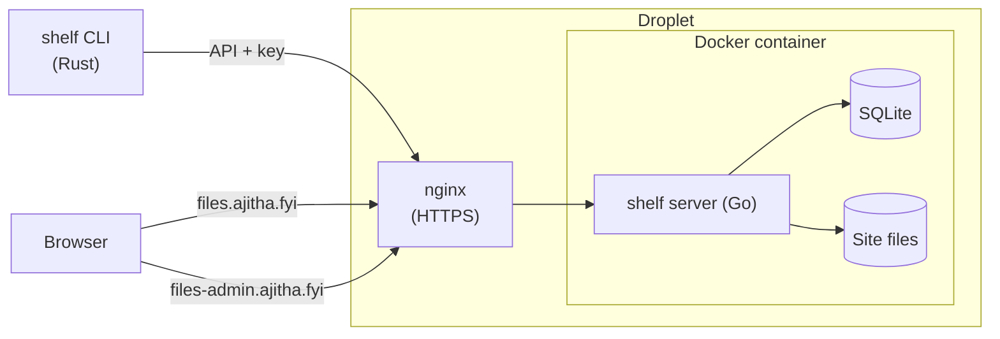

# shelf

[](https://github.com/kelpikz/shelf/actions/workflows/ci.yml)

`shelf` is a small personal host for static files. You upload a file or a folder with one command, and the server shows it on the web at its own path.

```sh
shelf upload ./my-notes notes
# Now online at https://files.ajitha.fyi/notes/
```

I made it to learn, and I use it every day. It runs at [files.ajitha.fyi](https://files.ajitha.fyi) on a DigitalOcean droplet with 1 vCPU and 1 GB RAM.

## Features

- **One command to upload.** Upload a file or a folder to a path. An upload to a path that is in use replaces the Site in one step.
- **Public and Private Sites.** A new Site is Private. Only the Owner can see it. When you make it Public, it shows on the Index page.
- **Archive and delete.** Archive takes a Site offline but keeps its files. Delete removes it permanently.
- **Upload checks.** Before an upload, the CLI finds broken links, links that start with `/`, and secrets such as API keys.
- **GitHub login.** One Owner only, and no sign-up. The CLI logs in through the browser, the same as `gh auth login`.
- **Admin page.** Manage Sites and CLI keys in the browser.
- **Small and simple.** One Go process, one SQLite file, and one Docker image.

## Screenshots

**Upload a folder, then make it Public:**


**The Index page lists the Public Sites:**


**The Admin page manages Public, Private, and Archived Sites:**


## How it works



One server process answers two host names:

| Host | What it serves |
|---|---|
| `files.ajitha.fyi` | The Sites and the Index page. Visitors use it. |
| `files-admin.ajitha.fyi` | The Admin page, the GitHub login, and the API for the CLI. Only the Owner uses it. |

**Why two host names?** A browser lets scripts on one origin read everything on that same origin. An uploaded page can contain any script. When the Admin page and its login cookie are on a different origin, an uploaded script cannot use them.

**An upload, step by step:**

1. The CLI runs the Upload checks on your computer.
2. The CLI packs the files into one `tar.gz` archive and sends it to the API.
3. The server checks the archive limits, unpacks it into a new folder, and then switches the Site to that folder.
4. If something fails, the old Site stays online as it was.

## Words we use

| Word | Meaning |
|---|---|
| **Site** | One file or one folder at one path, for example `/notes`. |
| **Owner** | The one person who can upload and manage Sites. |
| **Visitor** | Any other person who opens a Site. |
| **Visibility** | Public (anyone can see it) or Private (only the Owner can see it). |
| **Archived** | Offline for Visitors, but the files stay. |
| **Index page** | The page at `/` that lists the Public Sites. |

See [CONTEXT.md](CONTEXT.md) for the full glossary.

## The CLI

### Install

Install Rust, then build the CLI from this repo:

```sh
cargo install --path cli
```

This puts the `shelf` command on your `PATH`.

### Log in

```sh
shelf config set --server https://files-admin.example.com   # your admin host
shelf login                                                  # opens the browser
shelf status
```

The CLI keeps its key in the system key store (Windows Credential Manager, macOS Keychain, or the Secret Service on Linux). A key is valid for 30 days. You can cancel a key on the Admin page.

> On a Linux machine with no desktop, there is usually no Secret Service. Set the `SHELF_KEY` env variable there in place of `shelf login`.

### Commands

| Command | What it does |
|---|---|
| `shelf upload <source> <path>` | Upload a file or a folder to a Site. |
| `shelf check <source>` | Run the Upload checks only. It sends nothing. |
| `shelf list [--all]` | List the Sites. `--all` also shows Archived Sites. |
| `shelf public <path>` / `shelf private <path>` | Change the Visibility of a Site. |
| `shelf archive <path>` / `shelf unarchive <path>` | Take a Site offline, or put it back online. |
| `shelf delete <path>` | Delete a Site and its files. You type the path to confirm. |
| `shelf login` / `shelf logout` / `shelf status` | Manage the login of this computer. |
| `shelf set --name <name>` | Change the device name that the Admin page shows. |
| `shelf config set/get/unset --server` | Save the address of your server. |

Run `shelf <command> --help` for all the options.

### Rules for uploads

- A path is one level, with lower case letters, digits, and `-`.
- A folder must have an `index.html`.
- Files that start with `.` are not uploaded.
- The limits are 10 MiB for the archive and 50 MiB after it is unpacked.
- Links in HTML must be relative. A link that starts with `/` goes to the root of the host, not to your Site. The CLI warns you about these links.

## Run the server

### Deploy

The server runs as one Docker image with one data volume, behind your own HTTPS proxy. See [deploy/README.md](deploy/README.md) for the steps.

You need:

- Two host names, one for the Sites and one for the Admin page.
- A [GitHub OAuth app](https://github.com/settings/developers) for the login.
- The email address and the numeric GitHub ID of the Owner.

[server/prod.example.env](server/prod.example.env) lists all the settings.

### Local development

You need Go and Rust.

```sh
# Server
cd server
cp local.example.env .env    # then fill in the values
go run .

# CLI, in a second terminal
cd cli
SHELF_URL=http://localhost:8080 cargo run -- status
```

With the local settings, the Admin page is at `http://localhost:8080` and the Sites are at `http://files.localhost:8080`.

### Tests

```sh
cd server && go test ./...
cd cli && cargo test
```

CI runs the tests, the format and lint checks, and a Docker build for each pull request.

## Repo layout

| Path | What it is |
|---|---|
| `server/` | The Go server: login, Admin page, API, Sites, and serving. |
| `cli/` | The Rust CLI. The command is `shelf`. |
| `deploy/` | How to run the server with Docker. |
| `Dockerfile`, `compose.yaml` | The image and the container settings. |
| `CONTEXT.md` | The glossary. |

## Not in v1

Analytics, Site versions with rollback, Unlisted Sites, cache rules and compression, and a second login provider.

## Licence

[MIT](LICENSE)
